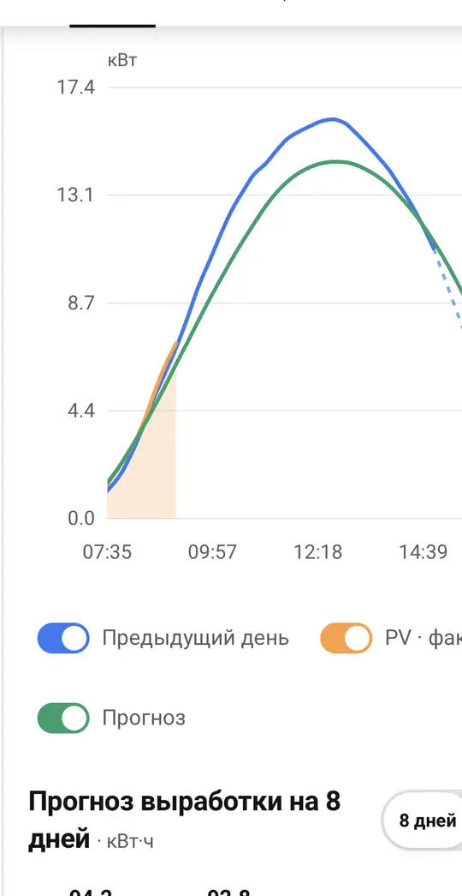
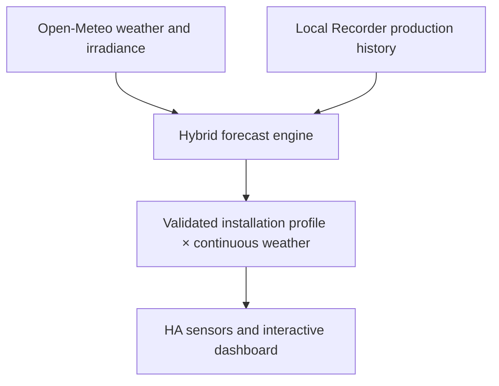

<div align="center">


# Solar Yield Forecast

### Adaptive, weather-aware PV production forecasting for Home Assistant

[](https://github.com/EvgenyKrinets/solar-yield-forecast/releases/latest)
[](https://www.home-assistant.io/)
[](https://hacs.xyz/)
[](LICENSE)

[](https://github.com/EvgenyKrinets/solar-yield-forecast/actions/workflows/validate.yml)
[](https://github.com/EvgenyKrinets/solar-yield-forecast/stargazers)
[](https://github.com/EvgenyKrinets/solar-yield-forecast/issues)

**English** · [Русский](README_RU.md) · [Releases](RELEASE_NOTES.md) · [Forecast accuracy](FORECAST_ACCURACY.md)

[](https://my.home-assistant.io/redirect/hacs_repository/?owner=EvgenyKrinets&repository=solar-yield-forecast&category=integration)

</div>

Solar Yield Forecast turns weather data and your own production history into an installation-specific solar forecast. It supports arbitrary locations, multiple panel orientations, local learning, interactive history and forecasts up to 30 days.

The learning layer runs inside Home Assistant. It is adaptive statistical intelligence rather than a remote black-box AI service: your measured production history remains local, while only site coordinates and panel geometry are sent to Open-Meteo for weather and irradiance forecasts.

## Why this integration?

Generic PV calculators know panel capacity and sunlight, but they do not know your roof. Solar Yield Forecast learns the repeatable shape of the real installation—including orientation mix, broad shading, clipping and systematic morning/evening bias—then continuously applies forecast irradiance, cloud cover, temperature and wind.

<table>
<tr>
<td width="33%" valign="top"><strong>☀️ Installation-specific</strong><br><br>Learns a validated power shape from complete, provider-confirmed clear days.</td>
<td width="33%" valign="top"><strong>🌦️ Weather always active</strong><br><br>Open-Meteo GTI and atmospheric conditions modify every forecast interval.</td>
<td width="33%" valign="top"><strong>🧠 Local adaptation</strong><br><br>Calibration, production history and learning samples stay in Home Assistant.</td>
</tr>
<tr>
<td valign="top"><strong>🧭 Multi-orientation arrays</strong><br><br>Configure up to 12 panel groups with independent count, wattage, tilt and azimuth.</td>
<td valign="top"><strong>📈 Interactive analytics</strong><br><br>Day, week, month, year and lifetime views with touch zoom and navigation.</td>
<td valign="top"><strong>🔭 30-day outlook</strong><br><br>High-resolution near-term weather plus a lower-confidence ensemble extension.</td>
</tr>
</table>

## Dashboard preview

<div align="center">

</div>

The bundled Lovelace card compares the previous day, measured PV production and the forecast profile. It also provides 8-day and 30-day energy bars, calendar navigation, history drill-down, pinch zoom, pan and expanded view.

## How it works



For each interval, the integration combines:

```text
forecast power = physical PV estimate × daily calibration × learned shape × bounded live correction
```

- **Physical estimate:** tilted irradiance for every configured panel group, temperature and wind.
- **Daily calibration:** robust median comparison between historical modeled and measured energy; it controls total kWh, not peak height by itself.
- **Learned shape:** a persisted, validated profile from clear, complete production days redistributes those kWh across the day; cloudy days cannot carve false dips into it.
- **Live correction:** today's remaining forecast adapts gradually from the latest 90 minutes of measured PV power and may reach ±20% after eight consistent samples.
- **Weather continuity:** cloud and irradiance effects are never switched off.

## Features

- UI setup and reconfiguration—no YAML required for the integration itself.
- Custom site name, latitude, longitude and IANA time zone.
- Selectable daily-energy and live-PV-power sensors.
- Up to 12 independent panel groups.
- Automatic installed-capacity summary before saving.
- 15-minute forecast profile where provider data is available, with safe hourly fallback.
- Previous-day, current-day and forecast power curves.
- Saved daily energy history without filling missing dates with fake zeros.
- Today, tomorrow, 7-day and 30-day energy sensors.
- Retrospective training diagnostics and separately tracked forward forecast error.
- Automatic frontend registration of wide and compact Lovelace cards.
- English and Russian setup translations.
- DST-safe local calendar navigation.

## Requirements

| Requirement | Minimum / notes |
|---|---|
| Home Assistant | `2025.1.0` or newer |
| HACS | Recommended for installation and updates |
| Internet | Required for Open-Meteo forecast requests |
| Recorder | Strongly recommended for profile learning and historical charts |
| Daily energy sensor | A monotonically increasing daily PV value in `kWh` |
| Live PV power sensor | PV power in `W` or `kW` |

## Installation

### HACS custom repository

1. Open **HACS → Integrations**.
2. Open the menu and choose **Custom repositories**.
3. Add:

   ```text
   https://github.com/EvgenyKrinets/solar-yield-forecast
   ```

4. Select category **Integration**.
5. Install **Solar Yield Forecast**.
6. Restart Home Assistant.
7. Open **Settings → Devices & services → Add integration → Solar Yield Forecast**.
8. Complete the site and panel-group wizard, then open **Solar Forecast** from
   the Home Assistant sidebar. No manual dashboard YAML is required.

Or use the **Open in HACS** button at the top of this page.

### Manual installation

Copy the directory:

```text
custom_components/solar_yield_forecast
```

to:

```text
/config/custom_components/solar_yield_forecast
```

Restart Home Assistant, then add the integration from **Devices & services**.

## Configuration

The setup wizard asks for:

| Setting | Description |
|---|---|
| Site name | Friendly installation or city name |
| Latitude / longitude | Defaults to the Home Assistant home location |
| Time zone | IANA zone such as `Asia/Jerusalem` |
| Daily production | Sensor that reports today's generated energy |
| Live PV power | Sensor that reports current PV power |
| Panel groups | Name, panel count, panel wattage, tilt and azimuth |

Azimuth is clockwise from geographic north:

| Direction | Azimuth |
|---|---:|
| North | `0°` |
| East | `90°` |
| South | `180°` |
| West | `270°` |

Panels with the same wattage, tilt and azimuth belong in one group. Open **Settings → Devices & services → Solar Yield Forecast → Configure** to change the site, sensors or array later. The entry reloads automatically and preserves its stored history.

## Dashboard

The integration automatically registers **Solar Forecast** as a dedicated
sidebar application. It uses the production and energy entities selected in the
setup wizard, so a new user does not need to find or configure the card.

When an administrator opens the sidebar application for the first time, the
integration also creates a valid managed **Solar Yield Forecast** dashboard in
Home Assistant's dashboard registry. That dashboard is hidden from the sidebar
because the dedicated application already occupies one sidebar entry.

The frontend card remains bundled for optional use on other dashboards. Add either:

- **Solar Comparison — Wide** (`custom:solar-comparison-card`)
- **Solar Comparison — Compact** (`custom:solar-comparison-compact`)

Minimal YAML:

```yaml
type: custom:solar-comparison-card
forecast_entity: sensor.solar_yield_forecast_power_profile_today
day_forecast_entity: sensor.solar_yield_forecast_today
```

See [`dashboard.yaml`](dashboard.yaml) for the complete example. For a three-column layout, use a **Sections** dashboard and place the wide card in a section spanning three columns.

If an older version was installed manually, remove `/local/solar-comparison-card.js` from Dashboard Resources to avoid loading duplicate frontend code.

## Entities

| Entity suffix | Unit | Purpose |
|---|---:|---|
| `model_today` | kWh | Whole-day modeled energy, independent of measured progress |
| `today` | kWh | Measured energy so far plus forecast remaining today |
| `tomorrow` | kWh | Tomorrow's forecast energy |
| `next_7_days` | kWh | Forecast total for the next seven complete days |
| `next_30_days` | kWh | Forecast total across the 30-day horizon |
| `remaining_today` | kWh | Estimated energy still available today |
| `power_now` | kW | Forecast mean power for the current interval |
| `power_profile_today` | kW | Today's forecast curve and 15-minute display points |
| `power_profile_tomorrow` | kW | Tomorrow's forecast curve |
| `calibration_factor` | % | Historical daily-energy scale factor |
| `calibration_samples` | days | Days used for daily calibration |
| `training_error` | % | Retrospective in-sample model error |
| `forward_error` | % | Error of saved day-ahead forecasts |
| `forward_samples` | days | Completed forward-forecast samples |

The `Today` sensor attributes also expose clear-day selection, learned shape factors, weather classification, live correction, saved baselines and site configuration.

## Forecast horizon and confidence

| Horizon | Source | Interpretation |
|---|---|---|
| Today–16 days | Open-Meteo regular forecast | Primary weather-aware estimate |
| Days 17–30 | GFS ensemble mean | Lower-confidence planning estimate |
| Historical profile | Local Recorder + stored samples | Installation-specific shape learning |

Striped long-range bars intentionally indicate lower confidence. Forecasts are estimates, not revenue-grade guarantees.

## Accuracy and limitations

- Weather timing is the largest unavoidable uncertainty, especially for local or fast-moving clouds.
- In regions without native 15-minute weather output, the provider may interpolate hourly data.
- Recorder retention limits how far detailed power curves can be reconstructed.
- Missing measurements remain missing; the integration does not invent zero production.
- Export limiting, battery charging policy, inverter clipping, curtailment, snow, dirt and temporary shading can affect measured production.
- The clear-day learner activates only after enough complete, validated history is available.
- `Training Error` describes retrospective fit. `Forward Forecast Error` is the relevant day-ahead metric after enough future days complete.

Read [FORECAST_ACCURACY.md](FORECAST_ACCURACY.md) for diagnostic details.

## Privacy

- Production measurements and learned samples stay in Home Assistant storage.
- No private production history is committed to this repository.
- Open-Meteo receives the configured coordinates and panel geometry needed to calculate irradiance.
- No API key or separate cloud account is required.

## Troubleshooting

| Symptom | Check |
|---|---|
| Integration is not listed | Restart Home Assistant after installation and clear the integration search |
| Card is missing | Restart Home Assistant and hard-refresh the browser/app |
| Dashboard reports that `views` is undefined | Update to the latest release, restart HA and open **Solar Forecast** once as an administrator |
| Old card still appears | Remove the manually registered `/local/solar-comparison-card.js` resource |
| Historical curve has gaps | Check Recorder retention and source sensor availability |
| Learned profile is inactive | Inspect `shape_calibration` on the `Today` sensor |
| Forecast is unavailable | Verify internet access and check the integration log for Open-Meteo errors |

When reporting a problem, include the Home Assistant version, integration version, relevant log entry and sanitized `Today` sensor diagnostics. Do not publish precise home coordinates or private energy history unless you deliberately choose to do so.

## Development

```bash
python -m pytest -q tests
node --test tests/test_card.cjs
python -m compileall -q custom_components/solar_yield_forecast
```

GitHub Actions also runs HACS validation, Python tests, frontend tests, browser rendering and compile checks for every pull request.

## Project status

- Public GitHub repository
- Semantic releases published through GitHub Releases
- HACS custom-repository installation supported
- Repository layout and metadata prepared for a future HACS default-catalog submission
- MIT licensed

See [RELEASE_NOTES.md](RELEASE_NOTES.md) for the complete version history.

## Contributing

Issues and focused pull requests are welcome. Please describe the installation layout, sensor units, expected behaviour and actual behaviour. Keep private recorder exports and exact residential coordinates out of public issues.

Read [CONTRIBUTING.md](CONTRIBUTING.md), [SECURITY.md](SECURITY.md) and the [Code of Conduct](CODE_OF_CONDUCT.md) before contributing.

## License

Released under the [MIT License](LICENSE).

---

<div align="center">

Built for real roofs, real weather and transparent Home Assistant automation.

</div>
