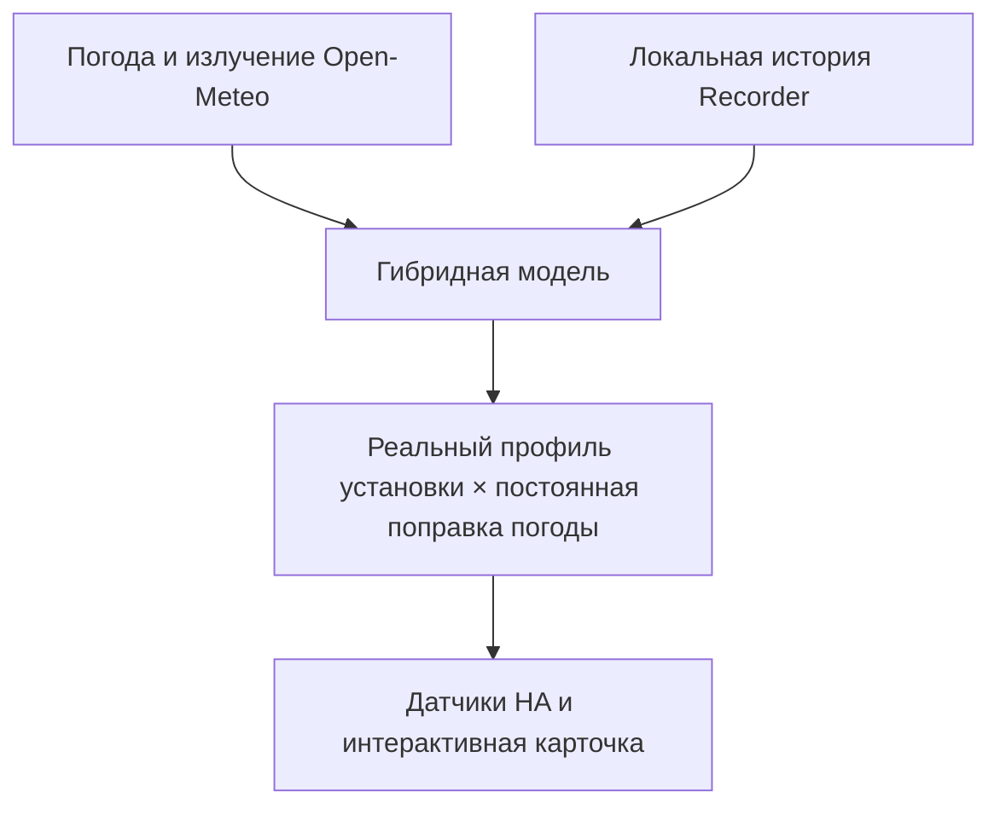

<div align="center">


# Solar Yield Forecast

### Адаптивный прогноз выработки солнечных панелей для Home Assistant

[](https://github.com/EvgenyKrinets/solar-yield-forecast/releases/latest)
[](https://www.home-assistant.io/)
[](https://hacs.xyz/)
[](LICENSE)

[](https://github.com/EvgenyKrinets/solar-yield-forecast/actions/workflows/validate.yml)

[English](README.md) · **Русский** · [История версий](RELEASE_NOTES.md) · [Точность прогноза](FORECAST_ACCURACY.md)

[](https://my.home-assistant.io/redirect/hacs_repository/?owner=EvgenyKrinets&repository=solar-yield-forecast&category=integration)

</div>

Solar Yield Forecast объединяет прогноз погоды и историю реальной выработки, чтобы построить индивидуальный прогноз именно для вашей установки. Поддерживаются произвольное расположение, несколько направлений панелей, локальное обучение, интерактивная история и прогноз до 30 дней.

Обучение выполняется внутри Home Assistant. Это прозрачная адаптивная статистическая модель, а не удалённый «чёрный ящик»: история выработки остаётся локально, а Open-Meteo получает только координаты и геометрию панелей, необходимые для расчёта погоды и солнечного излучения.

## Зачем нужна эта интеграция

Обычный калькулятор знает мощность панелей и положение солнца, но не знает особенностей вашей крыши. Solar Yield Forecast изучает повторяемую реальную форму установки—смешанные ориентации, широкое затенение, ограничение мощности, утреннее и вечернее отклонение—а затем постоянно корректирует её по прогнозу излучения, облачности, температуры и ветра.

<table>
<tr>
<td width="33%" valign="top"><strong>☀️ Индивидуальный профиль</strong><br><br>Форма обучается на полных ясных днях и проходит отдельную проверку.</td>
<td width="33%" valign="top"><strong>🌦️ Погода всегда учитывается</strong><br><br>GTI Open-Meteo и атмосферные условия корректируют каждый интервал.</td>
<td width="33%" valign="top"><strong>🧠 Локальная адаптация</strong><br><br>Калибровка, история и обучающие данные остаются в Home Assistant.</td>
</tr>
<tr>
<td valign="top"><strong>🧭 Разные направления</strong><br><br>До 12 групп с собственным количеством, мощностью, наклоном и азимутом.</td>
<td valign="top"><strong>📈 Интерактивный анализ</strong><br><br>День, неделя, месяц, год и всё время с навигацией и Zoom.</td>
<td valign="top"><strong>🔭 Прогноз на 30 дней</strong><br><br>Основной прогноз погоды и менее точное ансамблевое продолжение.</td>
</tr>
</table>

## Как выглядит карточка

<div align="center">

</div>

Карточка сравнивает предыдущий день, фактическую выработку и прогноз. Доступны столбцы на 8 и 30 дней, календарь, переход по истории, увеличение двумя пальцами, перемещение и полноэкранный режим.

## Как выполняется расчёт



```text
прогноз мощности = физическая модель × дневная калибровка × обученная форма × оперативная поправка
```

- **Физическая модель:** излучение на наклонной поверхности отдельно для каждой группы, температура и ветер.
- **Дневная калибровка:** устойчивое сравнение рассчитанной и фактической суточной энергии; коэффициент определяет суммарные кВт·ч, а не высоту пика сам по себе.
- **Обученная форма:** сохранённый проверенный профиль из полных ясных дней распределяет эти кВт·ч по времени; облачные дни не создают ложные провалы.
- **Оперативная поправка:** остаток текущего дня постепенно корректируется по последним 90 минутам мощности и после восьми согласованных измерений может достигать ±20%.
- **Непрерывная погода:** влияние облаков и излучения никогда не отключается.

## Основные возможности

- Установка и изменение настроек через интерфейс Home Assistant.
- Название места, координаты и часовой пояс IANA.
- Выбор датчика дневной энергии и датчика текущей мощности PV.
- До 12 независимых групп панелей.
- Расчёт общей установленной мощности перед сохранением.
- Профиль по 15 минут при наличии данных и безопасный часовой резервный вариант.
- Графики предыдущего дня, текущего дня и прогноза.
- День, неделя, месяц, год и всё время.
- Zoom двумя пальцами, перемещение, календарь и разворачивание графика.
- Прогноз сегодня, завтра, на 7 и 30 дней.
- Отдельная ошибка обучения и реальная ошибка сохранённых будущих прогнозов.
- Автоматическая регистрация широкой и компактной Lovelace-карточки.
- Английский и русский языки мастера настройки.
- Корректная работа календаря при переходе летнего времени.

## Требования

| Требование | Минимум / примечание |
|---|---|
| Home Assistant | `2025.1.0` или новее |
| HACS | Рекомендуется для установки и обновлений |
| Интернет | Необходим для запросов к Open-Meteo |
| Recorder | Настоятельно рекомендуется для обучения и истории |
| Датчик дневной энергии | Растущее в течение дня значение PV в `кВт·ч` |
| Датчик мощности PV | Текущая мощность в `Вт` или `кВт` |

## Установка через HACS

1. Откройте **HACS → Интеграции**.
2. В меню выберите **Пользовательские репозитории / Custom repositories**.
3. Добавьте:

   ```text
   https://github.com/EvgenyKrinets/solar-yield-forecast
   ```

4. Выберите категорию **Integration**.
5. Установите **Solar Yield Forecast**.
6. Перезапустите Home Assistant.
7. Откройте **Настройки → Устройства и службы → Добавить интеграцию → Solar Yield Forecast**.
8. Завершите мастер места и групп панелей, затем откройте **Solar Forecast** в
   левом меню Home Assistant. Вручную создавать Dashboard или вводить YAML не нужно.

Также можно нажать кнопку **Открыть в HACS** вверху страницы.

### Ручная установка

Скопируйте каталог:

```text
custom_components/solar_yield_forecast
```

в:

```text
/config/custom_components/solar_yield_forecast
```

Перезапустите Home Assistant и добавьте интеграцию через **Устройства и службы**.

## Настройка системы

Мастер запросит:

| Параметр | Описание |
|---|---|
| Название места | Название установки или города |
| Широта и долгота | По умолчанию берутся из Home Assistant |
| Часовой пояс | Например, `Asia/Jerusalem` |
| Дневная выработка | Датчик произведённой сегодня энергии |
| Текущая мощность | Датчик фактической мощности PV |
| Группы панелей | Название, количество, Вт на панель, наклон и азимут |

Азимут считается по часовой стрелке от географического севера:

| Направление | Азимут |
|---|---:|
| Север | `0°` |
| Восток | `90°` |
| Юг | `180°` |
| Запад | `270°` |

Панели с одинаковой мощностью, наклоном и азимутом следует объединить в одну группу. Для изменения параметров откройте **Настройки → Устройства и службы → Solar Yield Forecast → Настроить**. Интеграция перезагрузится автоматически, а накопленная история сохранится.

## Карточка Dashboard

Интеграция автоматически добавляет отдельное приложение **Solar Forecast** в
левое меню Home Assistant. Оно использует датчики мощности и энергии, выбранные
в мастере установки, поэтому пользователю не нужно искать и настраивать карточку.

Когда администратор впервые открывает этот пункт меню, интеграция также создаёт
корректный управляемый Dashboard **Solar Yield Forecast** в списке панелей Home
Assistant. Он скрыт из левого меню, чтобы там не появлялось два одинаковых пункта.

Карточка по-прежнему доступна для дополнительного ручного размещения на других
Dashboard. После перезапуска доступны:

- **Solar Comparison — широкий** (`custom:solar-comparison-card`)
- **Solar Comparison — компактный** (`custom:solar-comparison-compact`)

Минимальный YAML:

```yaml
type: custom:solar-comparison-card
forecast_entity: sensor.solar_yield_forecast_power_profile_today
day_forecast_entity: sensor.solar_yield_forecast_today
```

Полный пример находится в [`dashboard.yaml`](dashboard.yaml). Для ширины в три колонки используйте Dashboard типа **Sections** и секцию с шириной три колонки.

Если раньше JavaScript устанавливался вручную, удалите `/local/solar-comparison-card.js` из ресурсов Dashboard, чтобы не загружалась старая копия.

## Датчики

| Суффикс датчика | Единица | Назначение |
|---|---:|---|
| `model_today` | кВт·ч | Полная модель дня без подмены уже прошедшего времени фактом |
| `today` | кВт·ч | Фактическая энергия + прогноз оставшейся части дня |
| `tomorrow` | кВт·ч | Прогноз на завтра |
| `next_7_days` | кВт·ч | Сумма следующих семи полных дней |
| `next_30_days` | кВт·ч | Сумма прогноза на 30 дней |
| `remaining_today` | кВт·ч | Ожидаемый остаток текущего дня |
| `power_now` | кВт | Средняя прогнозная мощность текущего интервала |
| `power_profile_today` | кВт | Точки прогнозного профиля сегодня |
| `power_profile_tomorrow` | кВт | Точки прогнозного профиля завтра |
| `calibration_factor` | % | Коэффициент дневной калибровки |
| `calibration_samples` | дни | Количество дней дневной калибровки |
| `training_error` | % | Ретроспективная ошибка обучения |
| `forward_error` | % | Ошибка сохранённых прогнозов минимум за день вперёд |
| `forward_samples` | дни | Количество завершённых будущих прогнозов |

В атрибутах датчика `Today` также доступны выбранные ясные дни, коэффициенты формы, классификация погоды, оперативная поправка, сохранённые прогнозы и конфигурация места.

## Горизонт и точность

| Период | Источник | Назначение |
|---|---|---|
| Сегодня–16 дней | Основной прогноз Open-Meteo | Основная погодная оценка |
| 17–30 дней | Среднее ансамбля GFS | Менее точная плановая оценка |
| Историческая форма | Recorder и локальные точки | Индивидуальное обучение установки |

Полосатые дальние столбцы специально обозначают меньшую уверенность. Прогноз является оценкой, а не гарантией выработки.

### Известные ограничения

- Главная неопределённость—точное время локальной и быстро меняющейся облачности.
- В регионах без нативного прогноза на 15 минут провайдер может интерполировать часовые значения.
- Глубина детальной истории зависит от срока хранения Recorder.
- Пропущенные измерения остаются пропусками и не заменяются нулём.
- Ограничение экспорта, заряд батареи, clipping инвертора, загрязнение, снег и временная тень влияют на фактическую мощность.
- Обученная форма включается только после накопления достаточной полной и проверенной истории.
- `Training Error` показывает подгонку на прошлом. Для прогноза вперёд важен `Forward Forecast Error`.

Подробнее: [FORECAST_ACCURACY.md](FORECAST_ACCURACY.md).

## Приватность

- Измерения и обучающие точки остаются в хранилище Home Assistant.
- Личная история выработки не отправляется в GitHub.
- Open-Meteo получает координаты и геометрию панелей, необходимые для расчёта излучения.
- API-ключ и отдельная облачная учётная запись не требуются.

## Решение проблем

| Проблема | Что проверить |
|---|---|
| Интеграции нет в списке | Перезапустить Home Assistant после установки |
| Карточка не появилась | Перезапустить HA и полностью обновить страницу/приложение |
| Ошибка `views is undefined` | Обновить интеграцию, перезапустить HA и один раз открыть **Solar Forecast** с правами администратора |
| Показывается старая карточка | Удалить ручной ресурс `/local/solar-comparison-card.js` |
| В истории есть разрывы | Проверить Recorder и доступность исходного датчика |
| Обученная форма не включилась | Проверить атрибут `shape_calibration` датчика `Today` |
| Нет прогноза | Проверить интернет и журнал интеграции на ошибки Open-Meteo |

При создании Issue укажите версии Home Assistant и интеграции, текст ошибки и обезличенные диагностические атрибуты. Не публикуйте точные домашние координаты и приватную историю, если сознательно не решили это сделать.

## Разработка и проверки

```bash
python -m pytest -q tests
node --test tests/test_card.cjs
python -m compileall -q custom_components/solar_yield_forecast
```

GitHub Actions проверяет HACS-структуру, Python, интерфейс, браузерный рендеринг и компиляцию для каждого Pull Request.

## Статус проекта

- Публичный GitHub-репозиторий
- Семантические версии через GitHub Releases
- Установка как пользовательский репозиторий HACS
- Структура и метаданные подготовлены для будущей подачи в основной каталог HACS
- Лицензия MIT

Полная история: [RELEASE_NOTES.md](RELEASE_NOTES.md).

## Участие в проекте

Issues и небольшие целевые Pull Requests приветствуются. Опишите расположение панелей, единицы датчиков, ожидаемое и фактическое поведение. Не прикладывайте приватный экспорт Recorder и точные координаты жилого дома к публичным обращениям.

Перед участием прочитайте [CONTRIBUTING.md](CONTRIBUTING.md), [SECURITY.md](SECURITY.md) и [Code of Conduct](CODE_OF_CONDUCT.md).

## Лицензия

[MIT License](LICENSE).

---

<div align="center">

Для реальных крыш, реальной погоды и прозрачной автоматизации Home Assistant.

</div>
